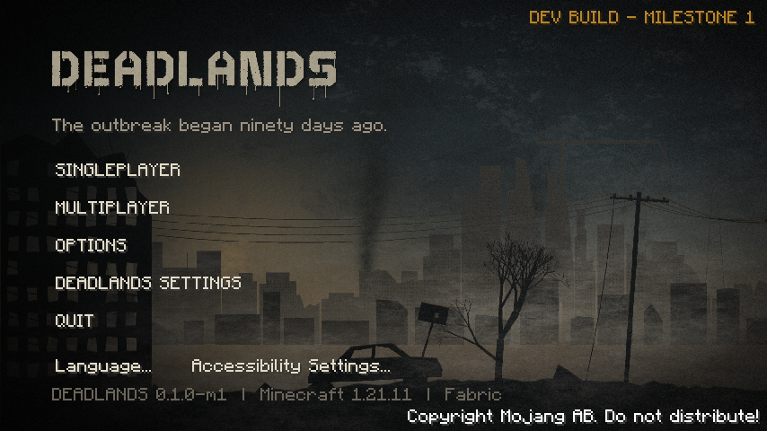
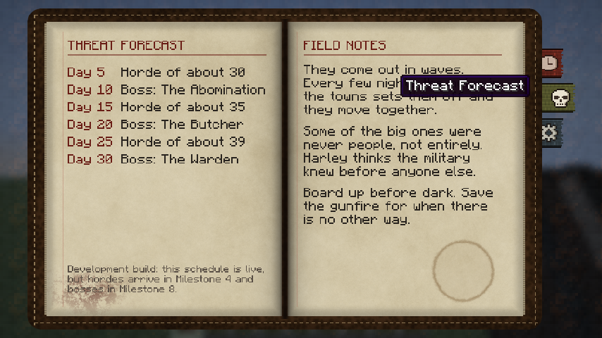
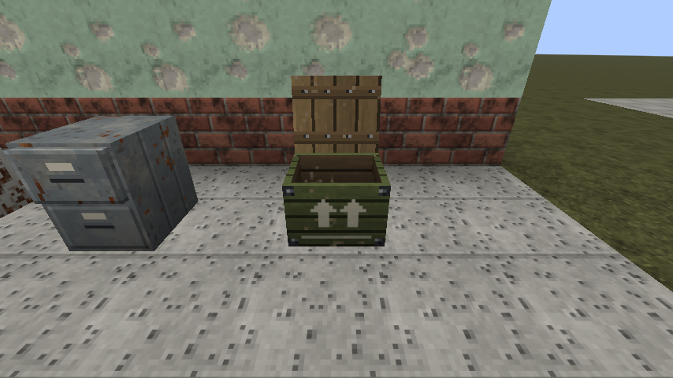
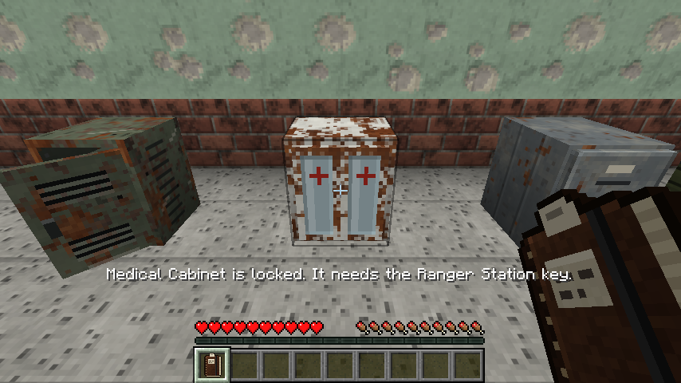
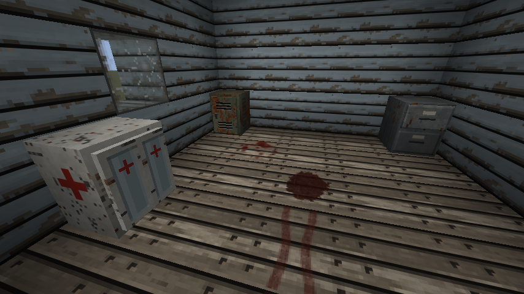
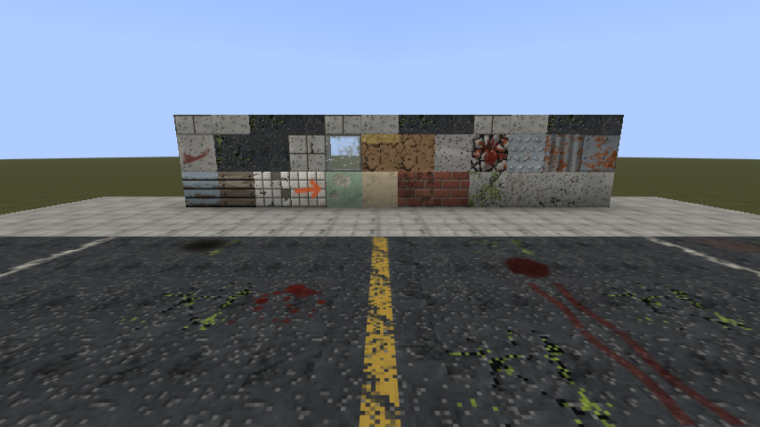
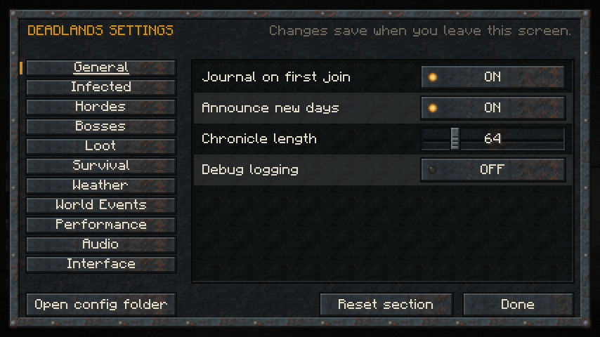
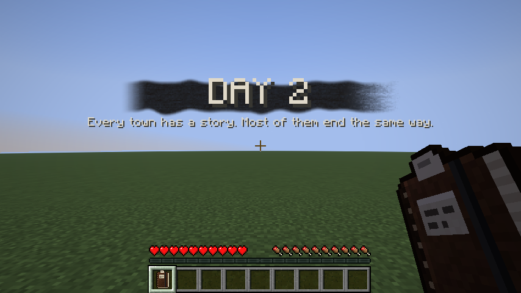

# DEADLANDS

A post-apocalyptic survival-horror RPG for **Minecraft Java 1.21.11** on **Fabric**. The outbreak
began ninety days ago; Harley needs your help. The goal is a standalone-feeling game built on
Minecraft's engine, developed in nine milestones.

**Current state: Milestones 1 (Foundation) and 2 (Visual foundation) are complete and tested.
Milestones 3 (World), 4 (Zombies), 5 (Survival), 6 (Vehicles), 7 (NPCs), 8 (Story) and 9 (Polish) are written and compile, but have never
been run or tested** (by request, no test runs and no game launches were made, so expect problems the first
time it is played). See [DEVELOPMENT_STATUS.md](DEVELOPMENT_STATUS.md) for exactly what exists and
what is missing.

## What you can see today

- A DEADLANDS main menu: layered parallax ruined-city backdrop with drifting fog and film grain,
  a spray-painted stencil logo and an original synthesized menu theme.
- Every vanilla menu restyled and shown over the DEADLANDS backdrop.
- The **Survivor's Journal** (given on first join, craftable, or press **J**): day, time and
  weather, your survival record, the world chronicle, the horde and boss forecast, field notes.
- A **DAY card** each in-game morning, with original sound.
- **29 building and ground blocks** (asphalt and road lines, sidewalk, concretes, bricks, plaster,
  hospital tiles, boards, sheet metal, rubble, ash, dead grass, broken glass, slabs) with LabPBR
  maps, **8 decals** (blood, drag marks, scorch, survivor mark) and a dry, desaturated retexture
  of the vanilla terrain.
- **Five lootable containers** (military crate, filing cabinet, medical cabinet, supply locker,
  toolbox) in four conditions, with animated lids, drawers and doors, their own sounds and
  screens, loot that rolls once, and **locks** opened by keys and keycards.
- **Two ruins** generated in the world: a roadside ranger shack (its locker holds the key to its
  locked medical cabinet) and an overrun supply cache.
- **DEADLANDS Settings**: every setting in one screen, also saved as a commented
  `config/deadlands.jsonc`.
- `/deadlands status | chronicle | day next | day set <n> | config reload | journal`.

Written for Milestone 3 but **not yet tried in game**:

- **Ten DEADLANDS biomes** replacing the vanilla land biomes (dead and burned forests, overgrown
  suburbs, abandoned farmland, dry wasteland, flooded marsh, dead pine valley, frozen outskirts,
  industrial wasteland, rural countryside), each with its own colours, fog, particles, ground
  cover, dead vegetation and synthesized ambience.
- **Highways, roads and dirt roads** between towns with painted lines, decay, snow, mud and
  flooding by climate, bridges, tunnels, pylons, poles, signs and roadblocks, and **railways**
  with trestles and platforms.
- **Towns** in four sizes up to **cities** with a street grid and traffic lights, in six
  conditions, plus **western towns** in the dry wasteland: **76 furnished building templates**
  (houses, shops, a diner, pharmacy, police station, town hall, church, clinics, apartment and
  office blocks, a bank, courthouse, fire stations, motels, saloons...) full of loot containers.
- **37 site templates outside towns**: the school in three states, ranger stations, hunting
  cabins, camps, checkpoints, watchtowers, bunkers, substations, water and radio towers, a power
  station, a treatment plant, silos, windmills and a research outpost.
- **Power restoration**: put a fuse in a generator and the street lamps of nearby towns come
  back on at night.
- **24 furniture and street blocks**, **five household containers** (cupboard, fridge, dresser,
  safe, school desk), and **town names and histories** with a town card when you arrive.

Written for Milestone 4 but **not yet tried in game**:

- **Nine kinds of infected** (walker, runner, brute, screamer, military, crawler, bloater,
  stalker, charred) in **58 looks**, on two custom rigs with their own walk cycles, attacks and
  voices. They replace vanilla monsters in DEADLANDS biomes.
- **AI** that hunts by sight and sound, searches where it last saw you, is drawn to light, moves
  in packs, alerts others and breaks through doors and barricades.
- **A noise system**: what you do is heard, and louder carries farther.
- **Nests** that fill up, listen, release their infected when disturbed and burst when destroyed.
- **Horde nights** every five days, with a warning at dusk, waves from one direction, a HUD
  counter and no sleeping through them, and **migrating groups** that travel between towns.
- `/deadlands horde start | stop | status`, `infected count | clear`, `noise <loudness>`.

Written for Milestone 5 (first part) but **not yet tried in game**:

- **Thirst, stamina, body temperature and fatigue**, with four small meters on screen.
- **Injuries**: bleeding, fractures, sickness, and an **infection** that kills in about three days
  unless treated.
- **23 food, drink and medical items** (cans, rations, bottled and dirty water, bandages, splints,
  antibiotics, antiviral serum, first aid kits) that replace the vanilla stand-ins in all loot.
- Four difficulty presets, from STORY (never lethal) to NIGHTMARE.
- **Five skills** that grow by use, **carrying weight**, four **melee weapons** and a **pistol**
  whose shots the infected hear from far away.

Screenshots from the automated client test:

| Main menu | Survivor's Journal |
|-----------|--------------------|
|  |  |
| **Containers, opened with real clicks** | **A locked medical cabinet** |
|  |  |
| **Inside the ranger shack** | **Materials and decals** |
|  |  |
| **DEADLANDS Settings** | **DAY card** |
|  |  |

Written for Milestone 6 but **not yet tried in game**:

- **Twelve vehicles** (sedan to fire truck, motorcycle, tractor) found abandoned along the roads,
  each in its own state of disrepair.
- **Restoration** with engine parts, tires, a battery and body panels; **fuel** from the pumps that
  still have some; **driving**, passengers, load space, and a dashboard.
- `/deadlands vehicle <kind>`.

Written for Milestone 7 but **not yet tried in game**:

- **Survivors** with names, roles, routines and factions living in the survivor, military and
  bandit towns, and travelling merchants on the road.
- **Conversations**, **trading** in 9 mm rounds, doctors and mechanics, and a **reputation** with
  each faction that sets prices and decides who shoots on sight.
- The four **recurring characters**, with replaceable skins, who point the way to each other.
- Survivors who **work**, carry their own things, have **people** they grieve for, and speak.
- **Settlements that change** day by day even while you are away, take gifts, turn away the
  unwelcome, keep curfews, and notice **theft**.
- Vehicles with **interiors, doors, headlights, a horn and towing**, dents and overgrowth on the
  model, more places to find them, and a restoration task in the journal.

Written for Milestone 8 but **not yet tried in game**:

- **The story**: an opening at Harley's camp, The Missing Research, The Cure and A Way Out, and
  quests for the other three characters.
- **134 lore entries** to find, read and keep in the journal's **archive**.
- A **radio** with five frequencies that change as the story moves and towers are repaired.
- **Keycard doors**, and the story's own places: the Kessler facility and Site Calder.
- **Five bosses** with their own attacks, and a **helicopter** to escape in.
- **Four endings**, one of them secret.

Written for Milestone 9 but **not yet tried in game**:

- **Weather** (fog, wind, dust storms) and **world events** (supply drops, crash sites, convoys,
  bandit patrols, distress calls, power outages).
- **Ambience by place**: hospitals, schools, factories, farms, bunkers and caves each sound different.
- **Cutscenes** at the story's turning points, **particles** (blood, spores, ash, embers), firearm
  recoil and a themed boss bar.
- A **finishing pass over the textures** (originals kept in `texture-backup/`).
- **Harley, Itzbreadloaf, Imlilylol and FelixSyn** in their own skins, fighting side by side, each
  met once per world while exploring.

## Requirements

| Tool | Version | Why |
|------|---------|-----|
| JDK 21 | Temurin 21 (installed) | Minecraft 1.21.11 compiles and runs on Java 21 |
| JDK 25 or newer | JDK 26 (installed) | Fabric Loom 1.19 must run Gradle on Java 25+ |
| Python 3.12 + numpy, scipy, Pillow, soundfile | only to regenerate assets | `tools/assetgen` |
| ffmpeg with libvorbis | only to regenerate sounds | OGG encoding |

`dev.ps1` picks a JDK 25+ for Gradle automatically, so you never need to change `JAVA_HOME`.

## Quick start (PowerShell, from this folder)

Build the mod and run the server game tests:

```bash
powershell -ExecutionPolicy Bypass -File .\dev.ps1 build
```

Play the development client (offline account, a fresh `run/` folder):

```bash
powershell -ExecutionPolicy Bypass -File .\dev.ps1 runClient
```

Run the automated end-to-end client test (opens a game window for about two minutes):

```bash
powershell -ExecutionPolicy Bypass -File .\dev.ps1 runClientGameTest
```

The mod jar is written to `build/libs/deadlands-<version>.jar`. To use it in a launcher, create a
Minecraft 1.21.11 profile with Fabric Loader 0.20.1+ and put the jar plus
Fabric API 0.141.6+1.21.11 in its `mods` folder.

## Project layout

```
src/main/java      common + server code   (com.deadlands...)
src/client/java    client-only code       (com.deadlands.client...)
src/gametest/java  automated server and client game tests
src/main/resources assets/ and data/ (all generated art and audio is committed)
tools/assetgen     Python generators for every texture and sound
docs/              architecture and testing guides
```

## Documentation

- [DEVELOPMENT_STATUS.md](DEVELOPMENT_STATUS.md): completed, partial and missing systems, known issues, next tasks
- [ASSET_STATUS.md](ASSET_STATUS.md): every texture, model, animation and sound, and the production plan
- [docs/ARCHITECTURE.md](docs/ARCHITECTURE.md): how the code is organised and how future systems plug in
- [docs/TESTING.md](docs/TESTING.md): automated tests and a reproducible manual checklist
- [tools/assetgen/README.md](tools/assetgen/README.md): regenerating art and audio

All DEADLANDS textures and sounds are original, generated by the scripts in `tools/assetgen`.
